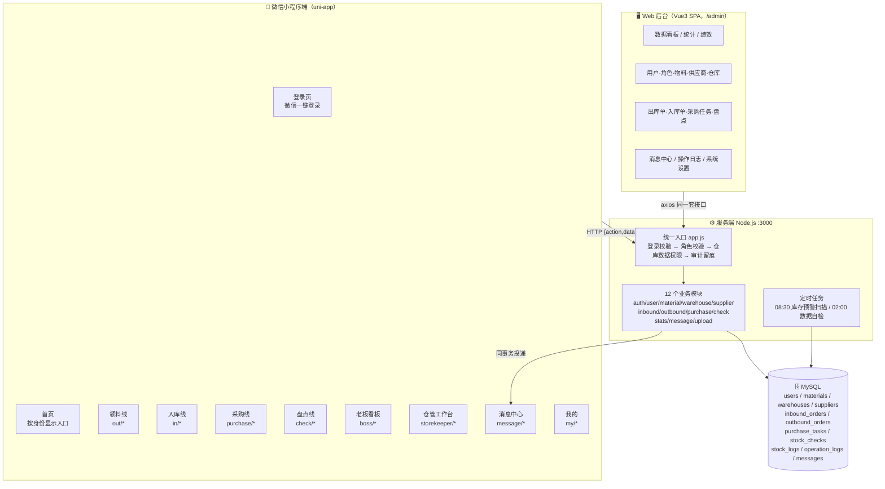
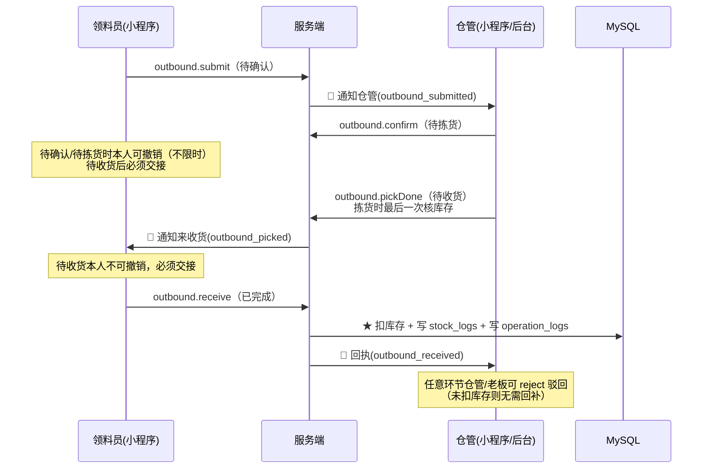
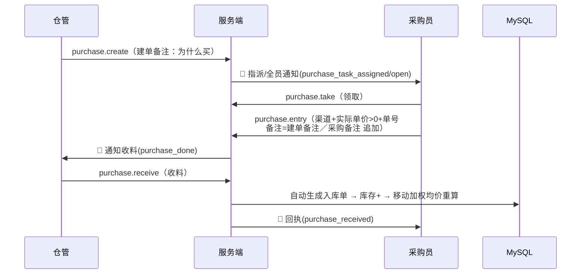
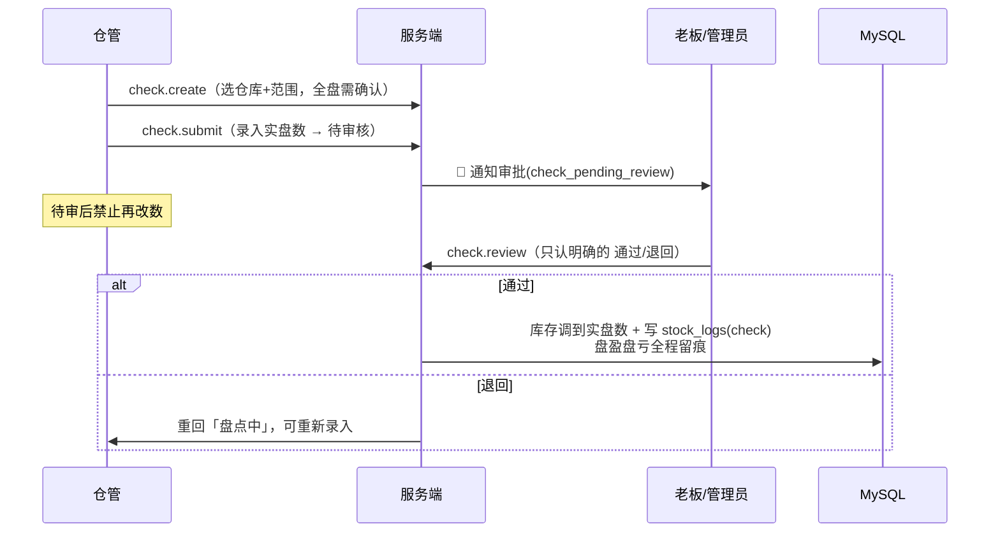
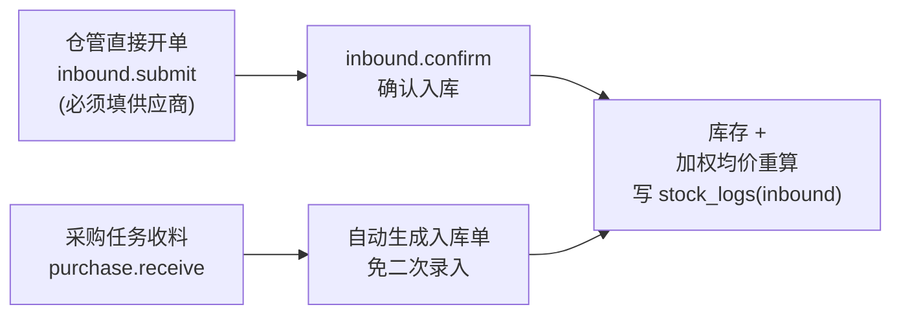
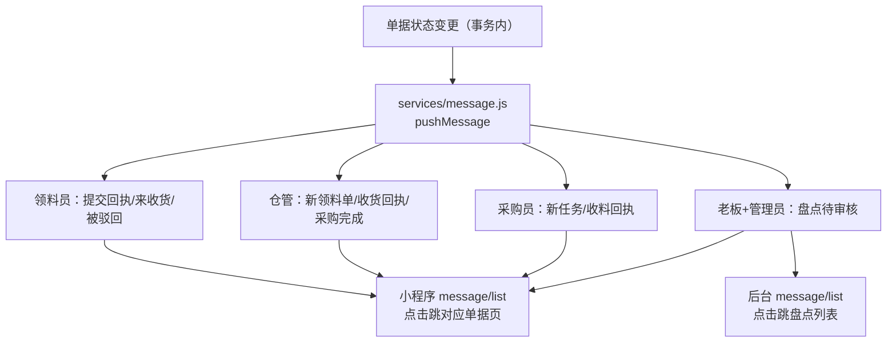
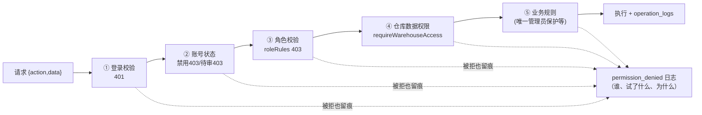

# 盛龙进销存 · 全功能报告表（小程序 + 后台）

> 盘点时间：2026-10-04（10-05 更新：建档并入入库页，页面 33→32）
> 范围：微信小程序端（32 个页面）、Web 后台（20 个路由）、服务端（12 个模块 / 约 90 个接口动作）
> 数据来源：源码逐项盘点（pages.json / router/index.js / modules/*.js），非凭印象

---

## 一、系统总览

**一句话**：小程序是「干活端」（按岗位出入口），后台是「管理端」（看数据、管主数据、审日志），
两端调**同一套服务端接口**，所有写操作过三道门（登录 → 角色 → 仓库数据权限）并留审计日志。

---

## 二、角色与权限矩阵

5 种角色（`user.js` 的 `VALID_ROLES`）：

| 角色 | 定位 | 小程序入口 | 后台 |
|---|---|---|---|
| `out` 领料员 | 车间领料 | 提交领料单、撤销、确认收货、查自己的单 | ❌ |
| `purchase` 采购员 | 只管买 | 领任务、录实际单价/单号、对账查流水 | ❌ |
| `storekeeper` 仓管员 | 管的最多 | 入库、确认/拣货/驳回、发采购任务、收料、盘点 | ❌ |
| `boss` 老板 | 决策与审批 | 看板、预警、盘点审批、驳回单据、全部数据 | ✅（可查） |
| `admin` 管理员 | 系统最高权限 | — | ✅ 全部 + 用户/角色管理 |

**权限三原则**（已固化进代码与测试）：
1. 「管理员」只能由管理员授予/剥夺，老板不能碰（立场 B）
2. 系统里永远至少有一个启用中的管理员（防死锁）
3. 仓库数据权限按人分配（例：领料员只有配件仓，仓管有配件仓+成品仓），接口层强制，前端藏按钮只是体验

---

## 三、小程序功能清单（33 页）

### 3.1 公共
| 页面 | 功能 |
|---|---|
| `login/login` | 微信一键登录（code2session）；开发构建支持 5 个测试身份一键切换；协议勾选拦截 |
| `agreement/user` `agreement/privacy` | 用户协议 / 隐私政策（提审必备，未登录可浏览） |
| `index/index` | 首页：按当前身份动态显示入口卡片（老板 4 个、全能 8 个） |
| `my/profile` | 我的：资料、开发身份切换（测试构建）、退出 |
| `message/list` | 消息中心：9 类通知，未读标记、全部已读、点击跳对应单据 |

### 3.2 领料线（领料员）
| 页面 | 功能 | 接口 |
|---|---|---|
| `out/submit` | 提交领料单（选物料、填数量，只能「领用」类型） | `outbound.submit` |
| `out/history` | 我的领料记录（按状态筛选） | `outbound.list` |
| `out/detail` | 领料单详情：撤销（待确认/待拣货）、**确认收货**（待收货，此时才真扣库存） | `outbound.cancel/receive` |

### 3.3 入库线（仓管）
| 页面 | 功能 | 接口 |
|---|---|---|
| `in/submit` | 直接入库开单（必须填供应商、单价>0）；**搜不到物料就地点「＋新增」就地建档，建完自动选中直接入** | `inbound.submit` `material.upsert` |
| `in/history` | 入库单列表 | `inbound.list` |
| `in/detail` | 入库单详情：确认入库（库存+加权均价联动）、改价 | `inbound.confirm/updatePrice` |

### 3.4 采购线（仓管发单 → 采购员买 → 仓管收料）
| 页面 | 功能 | 接口 |
|---|---|---|
| `purchase/task-create` | 仓管发布采购任务（可指定采购员） | `purchase.create` |
| `purchase/tasks` | 任务列表：待领取/采购中/待收料 | `purchase.list/myTodoCount` |
| `purchase/task-detail` | 任务详情：领取、录入（渠道/实际单价>0/外部单号，备注追加）；**收料清单按实际到货核对：任务明细预填、搜已有物料点选加入、没有的就地建档新增** | `purchase.take/entry/receive` |
| `purchase/submit` `purchase/history` `purchase/detail` | 采购员视角的提交与历史 | 同上 |
| `purchase/ledger` | 月底对账（出库流水、库存流水只读） | `stats.orderFlow/stockFlow` |

### 3.5 盘点线（仓管录入 → 老板审批）
| 页面 | 功能 | 接口 |
|---|---|---|
| `check/list` | 盘点单列表（仓管可见本仓全部） | `check.list` |
| `check/submit` | 录入实盘数（待审后禁改） | `check.submit` |
| `check/detail` | 详情与审批（老板：通过/退回，只认明确表态） | `check.review` |

### 3.6 老板看板
| 页面 | 功能 | 接口 |
|---|---|---|
| `boss/dashboard` | 看板：物料总数/库存总量/库存总值/预警数/零库存数、今日出入库、待办 | `stats.overview` |
| `boss/trend` | 出入库趋势 | `stats.trend` |
| `boss/stock` | 库存查询（多仓） | `stats.stockList` |
| `boss/orders` | 全部单据 | `outbound/inbound.list` |
| `boss/warning` | 预警明细（严重程度分级、可含闲置物料） | `stats.warning` |

### 3.7 仓管工作台
| 页面 | 功能 |
|---|---|
| `storekeeper/dashboard` | 待办聚合（待确认出库、待收料采购、预警） |
| `storekeeper/pending` | 待确认出库单：确认→待拣货；驳回 |
| `storekeeper/orders` | 管辖仓全部单据：拣货完成→待收货 |
| `storekeeper/stock` | 管辖仓库存查询 |

---

## 四、Web 后台功能清单（20 路由）

| 菜单 | 路由 | 功能 | 接口 |
|---|---|---|---|
| 数据看板 | `/dashboard` | 核心指标卡 + 预警/零库存跳转 | `stats.overview/warning` |
| 出入库统计 | `/stats/overview` | 按时间段统计 | `stats.trend/orderFlow` |
| 物料排行 | `/stats/material-rank` | 领用排行 | `stats.materialRank` |
| 人员绩效 | `/stats/operator-stats` | 按操作人统计 | `stats.operatorStats` |
| 配件仓/成品仓物料 | `/material/parts` `/material/product` | 按仓物料列表、预警筛选 | `material.list` |
| 全部物料 | `/material/list` | 不锁仓（看板跳转用） | `material.list` |
| 编辑物料 | `/material/edit` | 建档/改档（不能直改库存） | `material.upsert` |
| 批量导入 | `/material/import` | Excel 批量建档 | `material.import` |
| 出库单管理 | `/order/outbound` | 四态单据全流程管理 | `outbound.*` |
| 入库单管理 | `/order/inbound` | 入库单管理 | `inbound.*` |
| 采购任务 | `/order/purchase-tasks` | 任务全状态管理 | `purchase.*` |
| 盘点管理 | `/check/list` `/check/create` | 创建盘点（全盘守卫）、审批 | `check.*` |
| 消息中心 | `/message/list` | 与小程序消息互通 | `message.*` |
| 用户管理 | `/user/list` | 审核/角色/禁用/重置密码（权限门） | `user.*` |
| 角色管理 | `/role/list` | 角色说明 | — |
| 修改密码 | `/user/password` | 首次登录强制改密 | `auth.changePassword` |
| 操作日志 | `/system/logs` | 全量审计（含越权尝试） | `user.logs` |
| 系统设置 | `/setting/company` | 公司信息 | — |

---

## 五、核心链路图

### 5.1 出库链路（四态，库存在收货时才真扣）

### 5.2 采购链路（仓管发单 → 采购员买 → 仓管收料自动入库）

### 5.3 盘点链路（账面 → 实盘 → 审批调账）

### 5.4 入库链路（两条入口）

### 5.5 消息通知链路（9 类，全部与状态变更同事务）

### 5.6 权限与审计链路（每个请求都过这五道）

---

## 六、服务端接口总表（12 模块）

| 模块 | 动作 | 说明 |
|---|---|---|
| `auth` | login / adminLogin / register / updateProfile / getUserInfo / changePassword / myLogs | 微信登录 + 后台账号密码登录；首次登录强制改密 |
| `user` | list / detail / approve / updateRole / disable / enable / create / update / resetPassword / pendingCount / logs | 用户全生命周期；管理员角色双闸门（授予+剥夺都要管理员）；唯一管理员保护 |
| `material` | list / detail / upsert / import / delete / categories | 档案不能直接改库存（只能入库单/盘点调）；编号+名称同仓唯一 |
| `warehouse` / `supplier` | list / upsert / delete / search | 主数据，改动留痕 |
| `inbound` | submit / confirm / cancel / list / detail / updatePrice / pendingCount | 单价必须>0；幂等键防重复提交 |
| `outbound` | submit / confirm / pickDone / receive / reject / cancel / list / detail / pendingCount / pickingCount / myNotice | 四态流转；拆行合并校验库存；幂等 |
| `purchase` | create / take / entry / receive / rejectBack / cancel / list / detail / myTodoCount / assignees | 备注追加不覆盖；收料自动入库 |
| `check` | create / list / detail / submit / review / cancel | 待审禁改；审批只认明确布尔 |
| `stats` | overview / trend / stockList / orderFlow / warning / stockFlow / materialRank / operatorStats / warehouseSummary | 预警口径唯一出处 `services/warning.js`；金额两位小数 |
| `message` | list / unreadCount / markRead / markAllRead | 只查自己的（强制带 openid） |
| `upload` | upload / removeFile | 采购凭证等图片上传 |

**定时任务**：08:30 库存预警扫描（发现低于预警线自动发消息）；02:00 数据自检。

---

## 七、已知限制 / 未上线项（明确列出，不藏）

| 项 | 状态 |
|---|---|
| 微信真实登录（code2session） | 服务端已支持，但 `WX_APPID`/`WX_SECRET` 未配 → 目前只能开发身份登录 |
| HTTPS + 备案域名 | 未配 → 小程序正式版会被拦（提审前必须解决） |
| 协议主体信息 | 3 处占位符未替换（提审前必须填） |
| 隐私保护指引 | 用到了 chooseImage → 需在微信后台填写 |
| `material/delete` `supplier/delete` | 接口有，前端无入口（防误删，刻意） |
| 成品仓/配件仓 | 同一仓管员管理（业务设定） |
